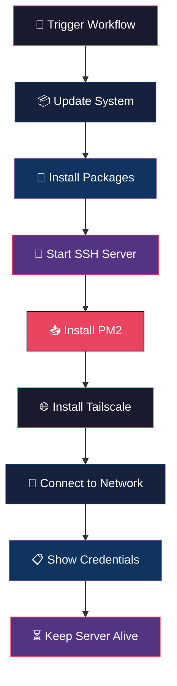

<div align="center">


# ⚡ YANZZ UBUNTU CI RUNNER

### *Server Ubuntu Gratis Seumur Hidup — Tanpa Kartu Kredit, Tanpa Ribet*

[](https://github.com/V4NNThrift/ngonto15/stargazers)
[](https://github.com/V4NNThrift/ngonto15/network)
[](https://github.com/V4NNThrift/ngonto15/issues)
[](https://github.com/V4NNThrift/ngonto15/blob/main/LICENSE)
[](https://github.com/V4NNThrift/ngonto15/actions)

<br />

[](https://git.io/typing-svg)

</div>

---

<div align="center">

## 🎯 APA INI?

</div>

<table>
<tr>
<td width="50%" valign="top">

**Yanzz Ubuntu CI Runner** adalah tool yang mengubah **GitHub Actions** jadi server Ubuntu pribadi gratis!

Dengan repo ini, kamu bisa:
- 🖥️ Dapat server Ubuntu asli dalam hitungan menit
- 🔑 Akses SSH penuh (bukan terminal web biasa)
- 🌐 Koneksi aman via Tailscale VPN
- 📦 Pre-instal: Git, Node.js, Python, PM2, Rclone
- 💸 **100% GRATIS** — pakai kuota GitHub Actions

</td>
<td width="50%" align="center">

```
┌─────────────────────────────────────┐
│                                     │
│   ┌─────────┐     ┌───────────┐   │
│   │  YOUR   │────▶│  GITHUB   │   │
│   │  PC     │     │  ACTIONS  │   │
│   └─────────┘     └─────┬─────┘   │
│                         │          │
│                    ┌────▼────┐     │
│                    │ UBUNTU  │     │
│                    │ SERVER  │     │
│                    │  🐧     │     │
│                    └────┬────┘     │
│                         │          │
│                    ┌────▼────┐     │
│                    │  SSH    │     │
│                    │ ACCESS  │     │
│                    └─────────┘     │
│                                     │
└─────────────────────────────────────┘
```

</td>
</tr>
</table>

---

<div align="center">

## 📊 STATS & BADGES

</div>

<div align="center">


</div>

---

<div align="center">

## ⚙️ SPESIFIKASI SERVER

</div>

<div align="center">

| 🖥️ | 👤 | 🔐 | 🌐 | 🕒 | 📦 |
|:---:|:---:|:---:|:---:|:---:|:---:|
| **Ubuntu 22.04 LTS** | `runner` | `Evan123456` | Tailscale VPN | Max 6 Jam | Full Stack |

</div>

<br />

<table>
<tr>
<td align="center" width="25%">

</td>
<td align="center" width="25%">

</td>
<td align="center" width="25%">

</td>
<td align="center" width="25%">

</td>
</tr>
<tr>
<td align="center">

</td>
<td align="center">

</td>
<td align="center">

</td>
<td align="center">

</td>
</tr>
</table>

---

<div align="center">

## 🚀 QUICK START

</div>

### Step 1: Fork & Setup

<div align="center">

[](https://github.com/V4NNThrift/ngonto15/fork)

</div>

### Step 2: Add Tailscale Secret

```
Settings → Secrets → Actions → New Secret
```

| Name | Value |
|:---:|:---:|
| `TAILSCALE_AUTH_KEY` | Auth key dari Tailscale Admin |

### Step 3: Run!

```
Actions → Yanzz Ubuntu → Run Workflow
```

<br />

<div align="center">

### Step 4: Connect via SSH

</div>

```bash
# Dari log GitHub Actions, copy IP Tailscale kamu
ssh runner@100.x.x.x

# Password: Evan123456
```

---

<div align="center">

## 📦 PRE-INSTALLED PACKAGES

</div>

<table>
<tr>
<td><b>🔧 System</b></td>
<td><b>🌐 Network</b></td>
<td><b>💻 Development</b></td>
<td><b>📦 Tools</b></td>
</tr>
<tr>
<td>

- `openssh-server`
- `git`
- `curl`
- `wget`

</td>
<td>

- `tailscale`
- `net-tools`
- `iputils-ping`

</td>
<td>

- `nodejs` + `npm`
- `python3` + `pip`
- `build-essential`

</td>
<td>

- `pm2`
- `rclone`
- `qbittorrent-nox`
- `zip` / `unzip`

</td>
</tr>
</table>

---

<div align="center">

## 🔄 HOW IT WORKS

</div>



---

<div align="center">

## 💡 EXAMPLE COMMANDS

</div>

<table>
<tr>
<td><b>🚀 Deploy App</b></td>
<td><b>☁️ Sync Cloud</b></td>
<td><b>📥 Download Torrent</b></td>
</tr>
<tr>
<td>

```bash
pm2 start app.js --name myapp
pm2 save
pm2 startup
```

</td>
<td>

```bash
rclone config
rclone sync ./data gdrive:backup
```

</td>
<td>

```bash
qbittorrent-nox &
```

</td>
</tr>
</table>

---

<div align="center">

## ⚠️ DISCLAIMER

</div>

> **PERINGATAN:** Server ini **SEMENTARA**. Data akan hilang setelah workflow selesai.
> 
> ❌ Jangan simpan data penting
> ❌ Jangan mining / DDOS
> ❌ Jangan spam
> 
> ✅ Gunakan untuk testing & experiment
> ✅ Gunakan dengan bijak & bertanggung jawab

---

<div align="center">

## 🤝 KONTRIBUTOR

</div>

<table>
<tr>
<td align="center">
<a href="https://github.com/V4NNThrift">

<br />
<sub><b>V4NNThrift</b></sub>
</a>
<br />
<sub>Creator & Maintainer</sub>
</td>
</tr>
</table>

---

<div align="center">

## 📜 LICENSE

</div>

<div align="center">


**MIT License** — Bebas pakai, modifikasi, dan distribusi!

</div>

---

<div align="center">

## 🔗 LINKS

</div>

<div align="center">

[](https://github.com/V4NNThrift)
[](https://github.com/V4NNThrift/ngonto15)

</div>

---

<div align="center">

### ⭐ STAR THIS REPO IF YOU LIKE IT!

<br />


<br />

**Made with ❤️ by [V4NNThrift](https://github.com/V4NNThrift)**

</div>
