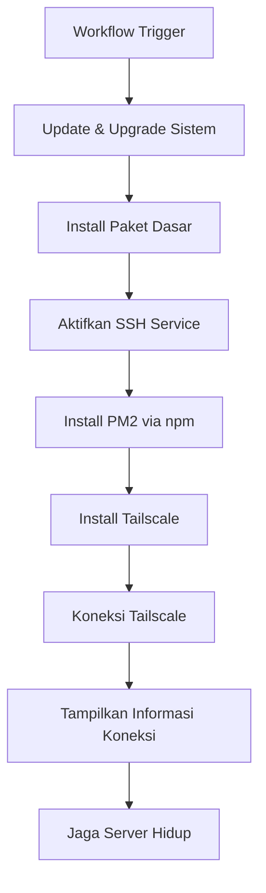

# 🐧 Yanzz Ubuntu CI Runner

> ⚡ **Gratis seumur hidku** — Deploy runner Ubuntu sementara dengan GitHub Actions + Tailscale. Dapatkan akses server penuh dengan sekali klik, tidak perlu kartu kredit!

<!-- Badges -->
<div align="center">

[](https://github.com/V4NNThrift/ngonto15/stargazers)
[](https://github.com/V4NNThrift/ngonto15/network)
[](https://github.com/V4NNThrift/ngonto15/blob/main/LICENSE)
[](https://github.com/V4NNThrift/ngonto15/actions/workflows/main.yml)


</div>

---

## 📋 Ringkasan Eksekutif

**Yanzz Ubuntu CI Runner** adalah solusi *self-hosted GitHub Actions runner* alternatif yang memberi Anda akses penuh ke mesin Linux (Ubuntu) hanya dengan satu klik. Cocok untuk pengembangan, testing, CI/CD eksperimental, hingga eksplorasi jaringan aman melalui Tailscale.

Dengan repo ini, Anda dapat:

- ✅ Dapatkan server Ubuntu nyata dalam hitungan menit
- ✅ Akses penuh lewat SSH (bukan sekadar terminal terbatas)
- ✅ Instalasi otomatis toolchain development standar
- ✅ Koneksi aman melalui jaringan pribadi Tailscale
- ✅ Gratis selama memakai GitHub Actions (1,800 menit/bulan)

---

## 🧰 Spesifikasi & Fitur

| Kategori         | Detail                                      |
|------------------|---------------------------------------------|
| 🖥️ Sistem         | Ubuntu 22.04 LTS                            |
| 👤 User           | `runner`                                   |
| 🔐 Password       | `Evan123456`                                |
| 🌐 Akses Jaringan | Tailscale                                   |
| 🕒 Durasi         | Hingga workflow dihentikan (max 360 menit)  |
| 🧰 Paket Terpasang| Git, curl, wget, python3, nodejs, npm       |
| 📦 Tools Lain     | unzip, zip, rclone, qbittorrent, pm2       |

---

## 📦 Daftar Paket yang Terpasang

Berikut adalah daftar paket yang akan otomatis terpasang saat workflow dijalankan:

```bash
sudo apt update
sudo apt upgrade -y
sudo apt install -y \
  openssh-server \
  git \
  curl \
  wget \
  unzip \
  zip \
  python3 \
  python3-pip \
  nodejs \
  npm \
  rclone \
  qbittorrent

# Global npm packages
sudo npm install -g pm2
```

---

## 🔐 Persiapan Awal (sekali saja)

Agar workflow berhasil terhubung ke jaringan Tailscale Anda, pastikan untuk menambahkan secret berikut ke repository ini:

| Nama               | Deskripsi                                |
|--------------------|-------------------------------------------|
| `TAILSCALE_AUTH_KEY` | Auth key dari akun Tailscale Anda      |

### Dapatkan Tailscale Auth Key

1. Buka [Tailscale Admin Console](https://login.tailscale.com/admin/settings/keys)
2. Klik "Generate Key"
3. Pilih jenis: *Ephemeral* (untuk keperluan sementara)
4. Salin key dan tambahkan sebagai secret di GitHub:
   - Buka Settings → Secrets and variables → Actions
   - Klik "New repository secret"
   - Masukkan nama: `TAILSCALE_AUTH_KEY`
   - Tempelkan nilai key

---

## 🚀 Panduan Lengkap: Cara Pakai

### 1. Jalankan Workflow


Atau buka tab **Actions → Yanzz Ubuntu → Run Workflow**

### 2. Monitor Progres

Buka tab **Actions** di GitHub untuk melihat progres instalasi. Butuh sekitar 3–5 menit.

### 3. Dapatkan Credential SSH & IP Tailscale

Setelah selesai, cek log di bagian paling akhir:

```
======================
SSH Host : 100.x.x.x
User     : runner
Password : Evan123456
======================
```

### 4. Konek ke Server Anda

#### Opção 1: SSH Langsung
```bash
ssh runner@100.x.x.x
# Password: Evan123456
```

#### Opção 2: Gunakan Tailscale SSH (jika tersedia)
```bash
tailscale ssh runner@yanzz-ubuntu
```

---

## 🛠️ Penggunaan Umum Setelah Koneksi

Setelah terhubung, berikut beberapa hal yang bisa dilakukan:

### Deploy Aplikasi dengan PM2
```bash
pm2 start app.js --name my-app
pm2 save
pm2 startup
```

### Sinkronisasi File ke Cloud dengan Rclone
```bash
rclone config
rclone sync ./local-folder gdrive:remote-folder
```

### Undu Torrent dengan qBittorrent Nohup
```bash
qbittorrent-nox &
```

---

## 🔄 Diagram Alur

Berikut alur kerja otomatis workflow ini:



---

## ⚠️ Disclaimer & Keamanan

- Workflow ini bersifat **sementara dan eksperimental**
- Server akan otomatis mati ketika workflow selesai atau timeout
- Jangan gunakan untuk menyimpan data penting—semua data akan hilang
- Hindari penggunaan berat (misalnya mining atau DDOS)—melanggar Terms of Service GitHub
- Gunakanlah dengan bijak dan bertanggung jawab

---

## 🤝 Kontributor

Terima kasih kepada semua yang sudah berkontribusi:

<div align="center">

| Kontributor         | Peran                   | GitHub                              |
|---------------------|--------------------------|-------------------------------------|
| [@V4NNThrift](https://github.com/V4NNThrift) | Creator & Maintainer     | [@V4NNThrift](https://github.com/V4NNThrift) |

</div>

---

## 📄 Lisensi

Lisensi **MIT** — Anda bebas memodifikasi, menyebarluaskan, dan mengembangkan lebih lanjut.

```
Permission is hereby granted, free of charge, to any person obtaining a copy
of this software and associated documentation files (the "Software"), to deal
in the Software without restriction, including without limitation the rights
to use, copy, modify, merge, publish, distribute, sublicense, and/or sell
copies of the Software, and to permit persons to whom the Software is
furnished to do so, subject to the following conditions:

The above copyright notice and this permission notice shall be included in all
copies or substantial portions of the Software.
```

---

## 📬 Kontak

- GitHub: [@V4NNThrift](https://github.com/V4NNThrift)
- Repo: [V4NNThrift/ngonto15](https://github.com/V4NNThrift/ngonto15)

<div align="center">
  
</div>
