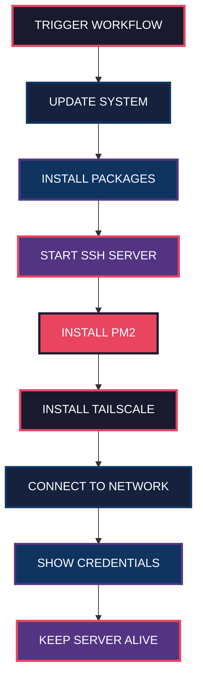

<div align="center">


<br/>


<br/>
<br/>


</div>

---

<div align="center">


</div>

---

## :dart: TENTANG PROJECT

<div align="center">

<table>
<tr>
<td width="50%" valign="top">

### Apa Itu?

**Yanzz Ubuntu CI Runner** adalah tool powerful yang mengubah **GitHub Actions** jadi server Ubuntu pribadi **GRATIS**!

Dengan repo ini, kamu bisa:

- :white_check_mark: Server Ubuntu asli dalam hitungan menit
- :white_check_mark: SSH penuh (bukan terminal web biasa)
- :white_check_mark: Pre-instal: Git, Node.js, Python, PM2, Rclone
- :white_check_mark: Koneksi aman via Tailscale VPN
- :white_check_mark: **100% GRATIS** tanpa kartu kredit

</td>
<td width="50%" align="center">

```
    +========================================+
    |                                        |
    |   +----------+                         |
    |   |   YOUR   |                         |
    |   |    PC    |                         |
    |   +----+-----+                         |
    |        |                               |
    |        v                               |
    |   +----------+     +----------+       |
    |   |  GITHUB  |---->|  UBUNTU  |       |
    |   |  ACTIONS |     |  SERVER  |       |
    |   +----------+     +----+-----+       |
    |                       |               |
    |                  +----v-----+         |
    |                  |   SSH    |         |
    |                  |  ACCESS  |         |
    |                  +----------+         |
    |                                        |
    +========================================+
```

</td>
</tr>
</table>

</div>

---

<div align="center">

## :bar_chart: BADGES & STATS

</div>

<div align="center">

[](https://github.com/V4NNThrift/ngonto15/stargazers)
[](https://github.com/V4NNThrift/ngonto15/network)
[](https://github.com/V4NNThrift/ngonto15/issues)
[](https://github.com/V4NNThrift/ngonto15/blob/main/LICENSE)
[](https://github.com/V4NNThrift/ngonto15/actions)

<br/>


<br/>


</div>

---

<div align="center">


<br/>


</div>

---

<div align="center">

## :gear: SPESIFIKASI SERVER

</div>

<div align="center">

| :desktop_computer: | :bust_in_shouette: | :key: | :globe_with_meridians: | :clock3: |
|:---:|:---:|:---:|:---:|:---:|
| **Ubuntu 22.04 LTS** | `runner` | `Evan123456` | Tailscale VPN | Max 6 Jam |

</div>

<table>
<tr>
<td align="center" width="25%">

```bash
+===========+
|  SYSTEM   |
|  -------- |
|  Ubuntu   |
|  22.04    |
|  LTS      |
+===========+
```

</td>
<td align="center" width="25%">

```bash
+===========+
|   USER    |
|  -------- |
|  runner   |
|           |
|           |
+===========+
```

</td>
<td align="center" width="25%">

```bash
+===========+
| PASSWORD  |
|  -------- |
|  Evan     |
|  123456   |
|           |
+===========+
```

</td>
<td align="center" width="25%">

```bash
+===========+
|  NETWORK  |
|  -------- |
| Tailscale |
|   VPN     |
|           |
+===========+
```

</td>
</tr>
</table>

---

<div align="center">

## :package: PRE-INSTALLED PACKAGES

</div>

<table>
<tr>
<td align="center" width="25%">

### :wrench: System

```bash
openssh-server
git
curl
wget
```

</td>
<td align="center" width="25%">

### :globe_with_meridians: Network

```bash
tailscale
net-tools
iputils-ping
```

</td>
<td align="center" width="25%">

### :computer: Development

```bash
nodejs + npm
python3 + pip
build-essential
```

</td>
<td align="center" width="25%">

### :package: Tools

```bash
pm2
rclone
qbittorrent-nox
zip / unzip
```

</td>
</tr>
</table>

---

<div align="center">

## :rocket: QUICK START GUIDE

</div>

<div align="center">

<table>
<tr>
<td align="center" width="25%">

### STEP 1


[](https://github.com/V4NNThrift/ngonto15/fork)

</td>
<td align="center" width="25%">

### STEP 2


```
Settings
Secrets
Actions
```

</td>
<td align="center" width="25%">

### STEP 3


```
Actions
Yanzz Ubuntu
Run
```

</td>
<td align="center" width="25%">

### STEP 4


```bash
ssh runner@IP
```

</td>
</tr>
</table>

</div>

---

<div align="center">

## :clipboard: ENVIRONMENT SETUP

</div>

### :locked: Secret yang Dibutuhkan

| Nama Secret | Deskripsi | Cara Dapatkan |
|:---:|:---:|:---:|
| `TAILSCALE_AUTH_KEY` | Auth key dari Tailscale | [Generate di sini](https://login.tailscale.com/admin/settings/keys) |

### :information_source: Langkah Setup

1. Buka [Tailscale Admin Console](https://login.tailscale.com/admin/settings/keys)
2. Klik **"Generate Key"**
3. Pilih **Ephemeral** (untuk keperluan sementara)
4. Copy key
5. Buka repo -> **Settings** -> **Secrets and variables** -> **Actions**
6. Klik **"New repository secret"**
7. Nama: `TAILSCALE_AUTH_KEY`
8. Value: tempel key dari Tailscale

---

<div align="center">

## :arrows_counterclockwise: HOW IT WORKS

</div>



---

<div align="center">

## :satellite: CONNECTION INFO

</div>

Setelah workflow selesai, cek log untuk mendapatkan info koneksi:

```
+----------------------------------------------+
|                                              |
|   +--------------------------------------+   |
|   |     SERVER CONNECTION INFO          |   |
|   |     ----------------------------    |   |
|   |                                      |   |
|   |   SSH Host : 100.x.x.x             |   |
|   |   User     : runner                 |   |
|   |   Password : Evan123456             |   |
|   |                                      |   |
|   +--------------------------------------+   |
|                                              |
+----------------------------------------------+
```

### :electric_plug: Cara Koneksi

<table>
<tr>
<td>

### Option 1: SSH Langsung

```bash
ssh runner@100.x.x.x
# Password: Evan123456
```

</td>
<td>

### Option 2: Tailscale SSH

```bash
tailscale ssh runner@gh-ubuntu-12345
```

</td>
</tr>
</table>

---

<div align="center">

## :hammer_and_wrench: EXAMPLE COMMANDS

</div>

<table>
<tr>
<td align="center" width="33%">

### :rocket: Deploy App

```bash
# Start app dengan PM2
pm2 start app.js --name myapp

# Save & auto-start
pm2 save
pm2 startup

# Monitor
pm2 monit
```

</td>
<td align="center" width="33%">

### :cloud: Cloud Sync

```bash
# Setup rclone
rclone config

# Sync ke Google Drive
rclone sync ./data gdrive:backup

# Cek status
rclone about gdrive:
```

</td>
<td align="center" width="33%">

### :arrow_down: Download

```bash
# Start qBittorrent
qbittorrent-nox &

# Download file
wget https://example.com/file.zip

# Unzip
unzip file.zip
```

</td>
</tr>
</table>

---

<div align="center">

## :warning: DISCLAIMER

</div>

<div align="center">

<table>
<tr>
<td align="center" width="50%">

### :x: JANGAN LAKUKAN

- Simpan data penting
- Mining cryptocurrency
- DDOS / Attack
- Spam / Abuse
- Illegal activities

</td>
<td align="center" width="50%">

### :white_check_mark: BOLEH LAKUKAN

- Testing & Experiment
- Learning & Development
- CI/CD Pipeline
- Deploy Project
- Backup Files

</td>
</tr>
</table>

**PERINGATAN:** Server ini **SEMENTARA**. Semua data akan hilang setelah workflow selesai!

</div>

---

<div align="center">

## :handshake: KONTRIBUTOR

</div>

<div align="center">

<table>
<tr>
<td align="center">

<a href="https://github.com/V4NNThrift">
  
  <br />
  <sub><b>V4NNThrift</b></sub>
</a>
<br />
<sub>Creator & Maintainer</sub>
<br />
<a href="https://github.com/V4NNThrift/ngonto15/stargazers">
  
</a>

</td>
</tr>
</table>

</div>

---

<div align="center">

## :scroll: LICENSE

</div>

<div align="center">

[](https://github.com/V4NNThrift/ngonto15/blob/main/LICENSE)

**MIT License** -- Bebas pakai, modifikasi, dan distribusi!

</div>

---

<div align="center">

## :globe_with_meridians: CONNECT WITH ME

</div>

<div align="center">

[](https://github.com/V4NNThrift)
[](https://github.com/V4NNThrift/ngonto15)

</div>

---

<div align="center">


<br/>


<br/>

### STAR THIS REPO IF YOU LIKE IT!

<br/>

**Made with :heart: by [V4NNThrift](https://github.com/V4NNThrift)**

</div>
