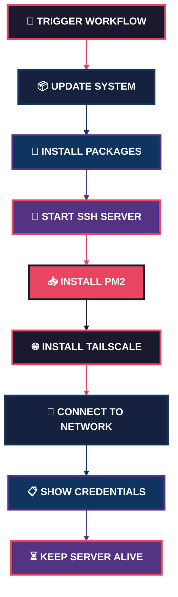

<div align="center">

<!-- Animated Header -->


<br/>

<!-- Profile Views -->


<br/>
<br/>

<!-- Typing Animation -->


</div>

---

<div align="center">

<!-- Animated Divider -->


</div>

---

##  TENTANG PROJECT

<div align="center">

<table>
<tr>
<td width="50%" valign="top">

###  Apa Itu?

**Yanzz Ubuntu CI Runner** adalah tool powerful yang mengubah **GitHub Actions** jadi server Ubuntu pribadi **GRATIS**!

Dengan repo ini, kamu bisa:

-  Server Ubuntu asli dalam hitungan menit
-  SSH penuh (bukan terminal web biasa)
-  Pre-instal: Git, Node.js, Python, PM2, Rclone
-  Koneksi aman via Tailscale VPN
-  **100% GRATIS** tanpa kartu kredit

</td>
<td width="50%" align="center">

```
    ╔══════════════════════════════════╗
    ║                                  ║
    ║   ┌──────────┐                   ║
    ║   │  YOUR    │                   ║
    ║   │   PC     │                   ║
    ║   └────┬─────┘                   ║
    ║        │                         ║
    ║        ▼                         ║
    ║   ┌──────────┐     ┌────────┐   ║
    ║   │  GITHUB  │────▶│UBUNTU  │   ║
    ║   │  ACTIONS │     │ SERVER │   ║
    ║   └──────────┘     └───┬────┘   ║
    ║                        │        ║
    ║                   ┌────▼────┐   ║
    ║                   │  SSH    │   ║
    ║                   │ ACCESS  │   ║
    ║                   └─────────┘   ║
    ║                                  ║
    ╚══════════════════════════════════╝
```

</td>
</tr>
</table>

</div>

---

<div align="center">

##  BADGES & STATS

</div>

<div align="center">

<!-- Main Badges -->
[](https://github.com/V4NNThrift/ngonto15/stargazers)
[](https://github.com/V4NNThrift/ngonto15/network)
[](https://github.com/V4NNThrift/ngonto15/issues)
[](https://github.com/V4NNThrift/ngonto15/blob/main/LICENSE)
[](https://github.com/V4NNThrift/ngonto15/actions)

<br/>

<!-- Tech Badges -->


<br/>

<!-- Platform & Status Badges -->


</div>

---

<div align="center">

<!-- GitHub Stats Cards -->


<br/>


</div>

---

<div align="center">

##  SPESIFIKASI SERVER

</div>

<div align="center">

<table>
<tr>
<td align="center" width="20%">

```ascii
  ╔═══════════╗
  ║  SYSTEM   ║
  ║  ━━━━━━   ║
  ║  Ubuntu   ║
  ║  22.04    ║
  ║  LTS      ║
  ╚═══════════╝
```

</td>
<td align="center" width="20%">

```ascii
  ╔═══════════╗
  ║   USER    ║
  ║  ━━━━━━   ║
  ║  runner   ║
  ║           ║
  ║           ║
  ╚═══════════╝
```

</td>
<td align="center" width="20%">

```ascii
  ╔═══════════╗
  ║ PASSWORD  ║
  ║  ━━━━━━   ║
  ║  Evan     ║
  ║  123456   ║
  ║           ║
  ╚═══════════╝
```

</td>
<td align="center" width="20%">

```ascii
  ╔═══════════╗
  ║  NETWORK  ║
  ║  ━━━━━━   ║
  ║ Tailscale ║
  ║   VPN     ║
  ║           ║
  ╚═══════════╝
```

</td>
<td align="center" width="20%">

```ascii
  ╔═══════════╗
  ║  UPTIME   ║
  ║  ━━━━━━   ║
  ║  Max 6    ║
  ║  Hours    ║
  ║           ║
  ╚═══════════╝
```

</td>
</tr>
</table>

</div>

---

<div align="center">

##  PRE-INSTALLED PACKAGES

</div>

<table>
<tr>
<td align="center" width="25%">

###  System

```bash
openssh-server
git
curl
wget
```

</td>
<td align="center" width="25%">

###  Network

```bash
tailscale
net-tools
iputils-ping
```

</td>
<td align="center" width="25%">

###  Development

```bash
nodejs + npm
python3 + pip
build-essential
```

</td>
<td align="center" width="25%">

###  Tools

```bash
pm2
rclone
qbittorrent-nox
zip / unzip
```

</td>
</tr>
</table>

---

<div align="center">

##  QUICK START GUIDE

</div>

<div align="center">

<table>
<tr>
<td align="center" width="25%">

### STEP 1


[](https://github.com/V4NNThrift/ngonto15/fork)

</td>
<td align="center" width="25%">

### STEP 2


```
Settings
Secrets
Actions
```

</td>
<td align="center" width="25%">

### STEP 3


```
Actions
Yanzz Ubuntu
Run
```

</td>
<td align="center" width="25%">

### STEP 4


```bash
ssh runner@IP
```

</td>
</tr>
</table>

</div>

---

<div align="center">

##  ENVIRONMENT SETUP

</div>

###  Secret yang Dibutuhkan

| Nama Secret | Deskripsi | Cara Dapatkan |
|:---:|:---:|:---:|
| `TAILSCALE_AUTH_KEY` | Auth key dari Tailscale | [Generate di sini](https://login.tailscale.com/admin/settings/keys) |

###  Langkah Setup

1. Buka [Tailscale Admin Console](https://login.tailscale.com/admin/settings/keys)
2. Klik **"Generate Key"**
3. Pilih **Ephemeral** (untuk keperluan sementara)
4. Copy key
5. Buka repo → **Settings** → **Secrets and variables** → **Actions**
6. Klik **"New repository secret"**
7. Nama: `TAILSCALE_AUTH_KEY`
8. Value: tempel key dari Tailscale

---

<div align="center">

##  HOW IT WORKS

</div>



---

<div align="center">

##  CONNECTION INFO

</div>

Setelah workflow selesai, cek log untuk mendapatkan info koneksi:

```
╔══════════════════════════════════════════════╗
║                                              ║
║   ╔══════════════════════════════════════╗   ║
║   ║     SERVER CONNECTION INFO          ║   ║
║   ║     ━━━━━━━━━━━━━━━━━━━━━━         ║   ║
║   ║                                      ║   ║
║   ║   🌐 SSH Host : 100.x.x.x         ║   ║
║   ║   👤 User     : runner             ║   ║
║   ║   🔐 Password : Evan123456         ║   ║
║   ║                                      ║   ║
║   ╚══════════════════════════════════════╝   ║
║                                              ║
╚══════════════════════════════════════════════╝
```

###  Cara Koneksi

<table>
<tr>
<td>

### Opção 1: SSH Langsung

```bash
ssh runner@100.x.x.x
# Password: Evan123456
```

</td>
<td>

### Opção 2: Tailscale SSH

```bash
tailscale ssh runner@gh-ubuntu-12345
```

</td>
</tr>
</table>

---

<div align="center">

##  EXAMPLE COMMANDS

</div>

<table>
<tr>
<td align="center" width="33%">

###  Deploy App

```bash
# Start app dengan PM2
pm2 start app.js --name myapp

# Save & auto-start
pm2 save
pm2 startup

# Monitor
pm2 monit
```

</td>
<td align="center" width="33%">

###  Cloud Sync

```bash
# Setup rclone
rclone config

# Sync ke Google Drive
rclone sync ./data gdrive:backup

# Cek status
rclone about gdrive:
```

</td>
<td align="center" width="33%">

###  Download

```bash
# Start qBittorrent
qbittorrent-nox &

# Download file
wget https://example.com/file.zip

# Unzip
unzip file.zip
```

</td>
</tr>
</table>

---

<div align="center">

##  DISCLAIMER

</div>

<div align="center">

<table>
<tr>
<td align="center" width="50%">

###  JANGAN LAKUKAN

- ❌ Simpan data penting
- ❌ Mining cryptocurrency
- ❌ DDOS / Attack
- ❌ Spam / Abuse
- ❌ Illegal activities

</td>
<td align="center" width="50%">

###  BOLEH LAKUKAN

- ✅ Testing & Experiment
- ✅ Learning & Development
- ✅ CI/CD Pipeline
- ✅ Deploy Project
- ✅ Backup Files

</td>
</tr>
</table>

**⚠️ PERINGATAN:** Server ini **SEMENTARA**. Semua data akan hilang setelah workflow selesai!

</div>

---

<div align="center">

##  KONTRIBUTOR

</div>

<div align="center">

<table>
<tr>
<td align="center">

<a href="https://github.com/V4NNThrift">
  
  <br />
  <sub><b>V4NNThrift</b></sub>
</a>
<br />
<sub>Creator & Maintainer</sub>
<br />
<a href="https://github.com/V4NNThrift/ngonto15/stargazers">
  
</a>

</td>
</tr>
</table>

</div>

---

<div align="center">

##  LICENSE

</div>

<div align="center">


**MIT License** — Bebas pakai, modifikasi, dan distribusi!

```
MIT License

Copyright (c) 2026 V4NNThrift

Permission is hereby granted, free of charge, to any person obtaining a copy
of this software and associated documentation files (the "Software"), to deal
in the Software without restriction, including without limitation the rights
to use, copy, modify, merge, publish, distribute, sublicense, and/or sell
copies of the Software, and to permit persons to whom the Software is
furnished to do so, subject to the following conditions:

The above copyright notice and this permission notice shall be included in all
copies or substantial portions of the Software.

THE SOFTWARE IS PROVIDED "AS IS", WITHOUT WARRANTY OF ANY KIND, EXPRESS OR
IMPLIED, INCLUDING BUT NOT LIMITED TO THE WARRANTIES OF MERCHANTABILITY,
FITNESS FOR A PARTICULAR PURPOSE AND NONINFRINGEMENT. IN NO EVENT SHALL THE
AUTHORS OR COPYRIGHT HOLDERS BE LIABLE FOR ANY CLAIM, DAMAGES OR OTHER
LIABILITY, WHETHER IN AN ACTION OF CONTRACT, TORT OR OTHERWISE, ARISING FROM,
OUT OF OR IN CONNECTION WITH THE SOFTWARE OR THE USE OR OTHER DEALINGS IN THE
SOFTWARE.
```

</div>

---

<div align="center">

##  CONNECT WITH ME

</div>

<div align="center">

[](https://github.com/V4NNThrift)
[](https://github.com/V4NNThrift/ngonto15)
[](mailto:your@email.com)

</div>

---

<div align="center">

<!-- Animated Footer -->


<br/>


<br/>

###  STAR THIS REPO IF YOU LIKE IT! 

<br/>

**Made with  by [V4NNThrift](https://github.com/V4NNThrift)**

</div>
